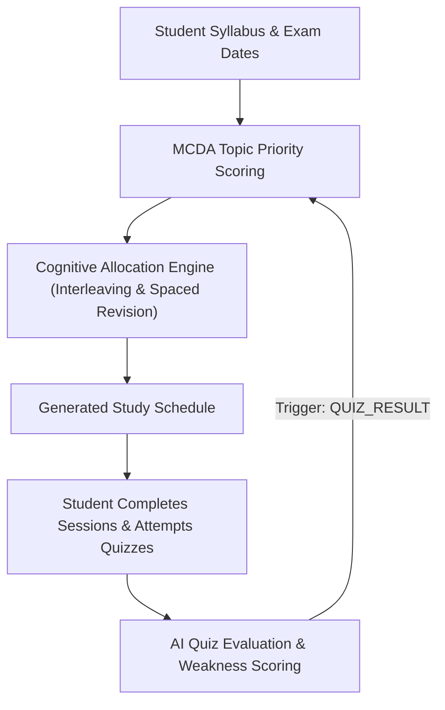

# AI Study Planner — Backend Logic & AI Architecture (`BackendLogic.md`)

This document serves as the complete technical, mathematical, and architectural reference for the backend and AI scheduling engine of the **AI Study Planner** application.

---

## Table of Contents
1. [System Overview & Architecture](#1-system-overview--architecture)
2. [Database Schema & Prisma Data Models](#2-database-schema--prisma-data-models)
3. [Multi-Criteria Decision Analysis (MCDA) Priority Engine](#3-multi-criteria-decision-analysis-mcda-priority-engine)
4. [Cognitive Scheduling & Allocation Engine](#4-cognitive-scheduling--allocation-engine)
5. [Natural Language Prompting (Gemini AI + Algorithmic Fallback)](#5-natural-language-prompting-gemini-ai--algorithmic-fallback)
6. [Active Recall & AI Quiz Generation](#6-active-recall--ai-quiz-generation)
7. [Closed-Loop Adaptive Feedback Mechanism](#7-closed-loop-adaptive-feedback-mechanism)
8. [API Route Specifications & Controller Architecture](#8-api-route-specifications--controller-architecture)
9. [Verification, Testing & Build Instructions](#9-verification-testing--build-instructions)

---

## 1. System Overview & Architecture

The AI Study Planner is built on an Express/Node.js + Prisma (MySQL) backend paired with a React + Vite frontend. Rather than maintaining static, manual revision schedules that ignore real-world progress, the backend provides an **adaptive closed-loop planning system**:



### Core Tenets
1. **Measurable Inputs**: Relies on factual inputs—exam proximity, estimated study hours, topic difficulty, and demonstrated quiz performance.
2. **Dual-Mode AI Capability**: Full Gemini API integration (`@google/genai`) for semantic understanding and quiz generation, backed by deterministic algorithmic fallbacks that guarantee 100% functionality even when offline or unauthenticated.
3. **Cognitive Science Principles**: Embeds the Pomodoro principle (chunking), cognitive interleaving (subject alternation), and spaced repetition/active recall.

---

## 2. Database Schema & Prisma Data Models

Located at [`backend/prisma/schema.prisma`](file:///c:/Users/naiti/MPRs_Sem7/ROSP/ai-study-planner/backend/prisma/schema.prisma):

- **`User`**: User profile holding credentials and configured `dailyStudyHours` (default: 2 hrs, range: 1–12 hrs).
- **`Subject`**: Academic subject with a target `examDate`.
- **`Topic`**: Specific unit of study under a subject with `difficulty` (`EASY`, `MEDIUM`, `HARD`), `estimatedHours`, and status (`ACTIVE`, `COMPLETED`).
- **`QuizQuestion`**: Diagnostic MCQs associated with a topic. Holds 4 options in JSON, `correctAnswer` (`A`, `B`, `C`, `D`), and pedagogical `explanation`.
- **`QuizAttempt`**: Records the student's performance (`score`, `totalQuestions`, `percentage`, `attemptedAt`).
- **`ScheduleVersion`**: Tracks schedule generation instances tagged by a `ScheduleTrigger`:
  - `INITIAL_GENERATION`: First schedule created.
  - `QUIZ_RESULT`: Automatically triggered after a quiz to adjust for topic weakness.
  - `MISSED_SESSION`: Re-allocates unstudied time over remaining days.
  - `MANUAL_REGENERATION`: User-initiated or prompted generation.
- **`StudySession`**: A single scheduled block with `date`, `startTime`, `durationMinutes`, `status` (`PLANNED`, `COMPLETED`, `MISSED`, `SKIPPED`), and `sessionType`:
  - `STUDY`: Deep initial learning session.
  - `REVISION`: Spaced review session for consolidation.
  - `QUIZ`: Active retrieval practice block.

---

## 3. Multi-Criteria Decision Analysis (MCDA) Priority Engine

Located at [`backend/src/utils/priority.ts`](file:///c:/Users/naiti/MPRs_Sem7/ROSP/ai-study-planner/backend/src/utils/priority.ts):

Each active topic is assigned a normalized priority score $P \in [0, 1]$ calculated via Multi-Criteria Decision Analysis (MCDA):

$$\text{Priority Score} = (w_1 \times \text{Exam Urgency}) + (w_2 \times \text{Topic Difficulty}) + (w_3 \times \text{Student Weakness})$$

### Configured Weights:
- $w_1 = 0.40$ (Exam Urgency)
- $w_2 = 0.30$ (Topic Difficulty)
- $w_3 = 0.30$ (Student Weakness)

$$\sum_{i=1}^3 w_i = 1.0$$

---

### Component Formulations:

#### 1. Exam Urgency ($U$)
Urgency models the urgency curve as the exam date approaches using hyperbolic decay:
$$d = \left\lceil \frac{\text{examDate} - \text{currentDate}}{1000 \times 60 \times 60 \times 24} \right\rceil$$

$$U = \begin{cases}
1.0 & \text{if } d \le 0 \\
\max\left(0.1, \frac{1}{1 + 0.1 \times d}\right) & \text{if } d > 0
\end{cases}$$

*Example Urgencies*:
- Exam tomorrow ($d = 1$): $U = \frac{1}{1 + 0.1} \approx 0.909$
- Exam in 7 days ($d = 7$): $U = \frac{1}{1 + 0.7} \approx 0.588$
- Exam in 30 days ($d = 30$): $U = \frac{1}{1 + 3.0} = 0.250$

#### 2. Topic Difficulty ($D$)
Direct mapping based on user assessment:
$$D = \begin{cases}
0.33 & \text{for } \text{Difficulty.EASY} \\
0.66 & \text{for } \text{Difficulty.MEDIUM} \\
1.00 & \text{for } \text{Difficulty.HARD}
\end{cases}$$

#### 3. Student Weakness ($W$)
Empirically computed from all historical quiz attempts on that topic:
$$W = \begin{cases}
0.50 & \text{if attempts is empty (untested)} \\
\max\left(0.0, 1.0 - \frac{\overline{\text{Score}}}{100}\right) & \text{where } \overline{\text{Score}} = \frac{1}{N} \sum_{i=1}^N \text{percentage}_i
\end{cases}$$

*Example Weaknesses*:
- 100% quiz average: $W = 0.0$ (mastered)
- 50% quiz average: $W = 0.5$ (moderate struggle)
- 0% quiz average: $W = 1.0$ (critical weakness)

---

## 4. Cognitive Scheduling & Allocation Engine

Located at [`backend/src/utils/allocation.ts`](file:///c:/Users/naiti/MPRs_Sem7/ROSP/ai-study-planner/backend/src/utils/allocation.ts):

### Key Algorithmic Features:
1. **Pomodoro Chunking**:
   - `MIN_SESSION_MINUTES = 30`
   - `MAX_SESSION_MINUTES = 60`
   - `BREAK_MINUTES = 15`
   - A topic requiring 150 minutes across a day is chunked into `[60 min, 60 min, 30 min]` sessions separated by 15-minute rest breaks, avoiding fatiguing marathons.

2. **Cognitive Interleaving**:
   - Sequential learning of identical topics leads to rapid cognitive fatigue.
   - The engine tracks `lastSubjectScheduled`. When selecting the next topic for the day, if the top priority topic belongs to the same subject as the previous session, the algorithm searches for an alternate candidate from a different subject.
   - If an alternate candidate has a priority score $\ge 70\%$ of the top candidate's score, it is scheduled next to enforce healthy interleaving.

3. **Spaced Revision & Active Recall Insertion**:
   - As described in project assignment specifications, studying once is insufficient for retention.
   - When a topic with `Difficulty.HARD` or $W \ge 0.40$ completes its initial study allocation, two future sessions are queued:
     - `SessionType.REVISION` (30 mins): Scheduled **2 days** after initial study completion.
     - `SessionType.QUIZ` (30 mins): Scheduled **4 days** after initial study completion for active retrieval practice.

4. **Custom Multipliers**:
   - Receives multiplier weights $m_t \in [0.1, 5.0]$ generated from custom prompts.
   - Topic priority is scaled as $P'_t = P_t \times m_t$.

---

## 5. Natural Language Prompting (Gemini AI + Algorithmic Fallback)

Located at [`backend/src/utils/ai_parser.ts`](file:///c:/Users/naiti/MPRs_Sem7/ROSP/ai-study-planner/backend/src/utils/ai_parser.ts):

When the student provides a custom instruction (e.g., *"Focus on Linked list more, give extra time to DBMS transactions"*):

### 1. Primary Engine: Gemini AI (`@google/genai`)
- Model: `gemini-2.5-flash`
- System instruction instructs the model to return a structured JSON array of `{ topicId: string, multiplier: number }`.
- Multipliers:
  - Default: `1.0`
  - High focus: `2.0` to `3.0`
  - Low priority / skip: `0.2` to `0.6`

### 2. Algorithmic Fallback Engine (`algorithmicFallbackParse`)
Runs automatically if `GEMINI_API_KEY` is missing, expired, or rate-limited:
- Employs regex word-boundary pattern matching (`/(^|\b|\W)term(\b|\W|$)/i`) on topic names and subject names.
- Analyzes intent keywords:
  - Boost: `["focus", "more", "priority", "prioritize", "urgent", "important", "heavy", "master", "struggling", "weak", "revise"]` $\rightarrow$ sets topic multiplier to **2.5×** (or **1.7×** for entire subject).
  - Reduce / Skip: `["less", "skip", "ignore", "don't", "avoid", "easy", "later"]` $\rightarrow$ sets topic multiplier to **0.2×** (skip) or **0.5×** (less).
  - Balancing: Slights unmentioned topics to **0.85×** when specific topics are explicitly boosted.

---

## 6. Active Recall & AI Quiz Generation

Located at [`backend/src/utils/quiz_generator.ts`](file:///c:/Users/naiti/MPRs_Sem7/ROSP/ai-study-planner/backend/src/utils/quiz_generator.ts):

### 1. Gemini AI Generator
Generates 3 to 4 diagnostic MCQs for any given topic with:
- `prompt`: Conceptual, examination-focused problem text.
- `options`: Array of 4 distinct choices.
- `answer`: Correct choice letter (`"A"`, `"B"`, `"C"`, or `"D"`).
- `explanation`: Pedagogical explanation why the answer is correct and why other options are distractor choices.

### 2. Algorithmic Knowledge Synthesizer Fallback
Synthesizes structured diagnostic questions tailored to the topic name, subject, and difficulty level when offline, ensuring students can always practice active recall without an API key.

---

## 7. Closed-Loop Adaptive Feedback Mechanism

Submitting a quiz at `POST /api/questions/:questionId/answer`:
1. Evaluates user choice against `correctAnswer`.
2. Persists a new `QuizAttempt` record (`score`, `totalQuestions: 1`, `percentage: 100` or `0`).
3. Updates topic weakness $W$.
4. **Triggers immediate adaptive rescheduling**:
   ```typescript
   await executeScheduleGeneration(user.id, ScheduleTrigger.QUIZ_RESULT);
   ```
5. If the student scored 0%, the topic weakness surges to 100%, causing its priority score to jump and re-ordering future sessions to dedicate more study and revision blocks to that topic.

---

## 8. API Route Specifications & Controller Architecture

Located at [`backend/src/routes/planner.routes.ts`](file:///c:/Users/naiti/MPRs_Sem7/ROSP/ai-study-planner/backend/src/routes/planner.routes.ts):

| Method | Endpoint | Controller Handler | Purpose |
| :--- | :--- | :--- | :--- |
| `GET` | `/api/planner` | `getPlannerData` | Fetches profile, subjects, topics with calculated AI priority scores, active sessions, and quiz bank |
| `POST` | `/api/subjects` | `createSubject` | Creates a new subject with exam date |
| `DELETE`| `/api/subjects/:subjectId` | `deleteSubject` | Deletes a subject and cascades |
| `POST` | `/api/subjects/:subjectId/topics` | `createTopic` | Adds a topic with difficulty & estimated hours |
| `PATCH`| `/api/topics/:topicId` | `updateTopicStatus` | Toggles topic completion (`ACTIVE` / `COMPLETED`) |
| `POST` | `/api/schedule/generate` | `generateStudySchedule` | Generates or regenerates schedule using AI custom prompt + MCDA + chunking |
| `PATCH`| `/api/sessions/:sessionId` | `updateSessionStatus` | Updates session status (`PLANNED`, `COMPLETED`, `MISSED`) |
| `POST` | `/api/topics/:topicId/questions` | `createQuestion` | Manually adds a question with choices & explanation |
| `DELETE`| `/api/questions/:questionId` | `deleteQuestion` | Deletes a question |
| `POST` | `/api/questions/:questionId/answer` | `answerQuestion` | Submits quiz answer & triggers adaptive rescheduling |
| `POST` | `/api/topics/:topicId/generate-quiz`| `generateAiQuestionsForTopic`| Generates AI quiz questions on-demand |

---

## 9. Verification, Testing & Build Instructions

### Running Tests
To run the automated Jest test suite for priority and allocation engines:
```bash
cd backend
npx jest
```
*Current status*: **9 / 9 tests passing** (`priority.test.ts` & `allocation.test.ts`).

### Typecheck
```bash
cd backend
npx tsc --noEmit
```
*Current status*: **0 errors**.

### Production Frontend Build
```bash
cd frontend
npm run build
```
*Current status*: **0 errors**, all assets bundled.

### Database Seeding
To populate realistic sample subjects, topics, and initial diagnostic questions:
```bash
cd backend
npx ts-node prisma/seed.ts
```

